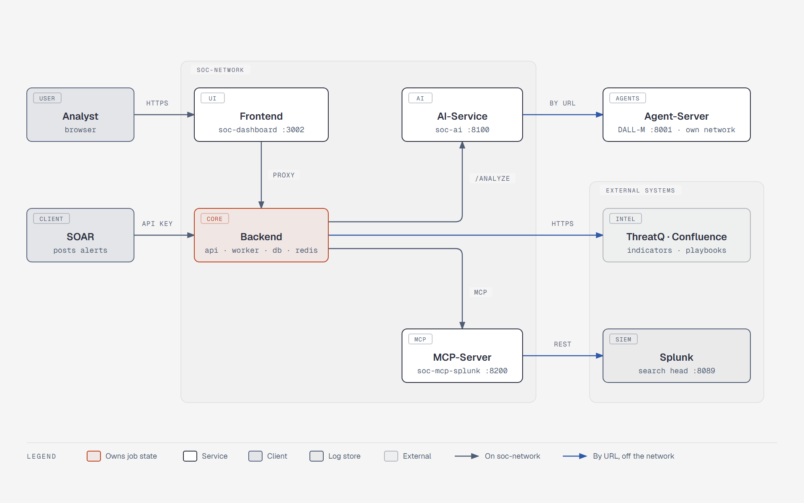

# Frontend

The analyst dashboard of SOC AI Agent. React and Vite, served by nginx.



## Run

```bash
docker network create soc-network     # once
docker compose up -d --build          # http://localhost:3002
```

The Dockerfile sends npm through an office proxy. Outside that network, build
with the proxy off:

```bash
docker compose build --build-arg NPM_PROXY= && docker compose up -d
```

## What it shows

The job list. For each job: the suggestion the model wrote, and beside it the
evidence it was written from — the extracted indicators, what threat
intelligence said about each, the matched playbook, and the search plan.

Splunk lookups run when the analyst presses a button, because each one costs
inference.

## How it reaches the API

nginx forwards `/auth`, `/v1`, `/admin` and `/health` to the Backend, so the
browser uses one origin and needs no CORS setup.

| Variable | Default | Meaning |
| --- | --- | --- |
| `BACKEND_HOST` | `soc-core-api` | The API's container name on `soc-network`. |
| `BACKEND_PORT` | `8000` | The API's port inside the network. |
| `FRONTEND_HOST_PORT` | `3002` | The port published on the host. |

nginx resolves the Backend on each request. The dashboard starts when the
Backend is down, and those paths answer 502 until it is up.

## Develop

```bash
npm install
BACKEND_URL=http://localhost:8082 npm run dev     # http://localhost:5173
```

Without `BACKEND_URL`, the dev server forwards to the address set in
`vite.config.js`.

## More

- Proxy details and deploy notes: [docs/reference.md](docs/reference.md)
- The whole system: [../README.md](../README.md)
